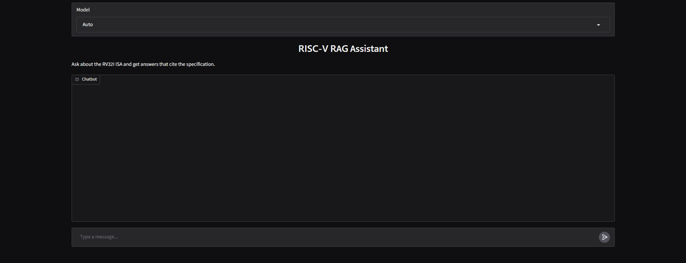

# riscv-rag-assistant

A RAG assistant that answers questions about the RISC-V specification (unprivileged ISA, RV32I
base) and cites the excerpts behind each answer. When the documentation doesn't cover a question,
it replies `I don't know based on the available documentation`.

You bring your own LLM through `.env`: Gemini, Groq, Ollama, or any OpenAI-compatible endpoint.
With no LLM configured, it runs in retrieval-only mode.



## Architecture

```text
Specification HTML + SVG figures
   └─ corpus: chapter > section > subsection tree
       └─ chunking: up to 250 words, one chunk per listed instruction and pseudoinstruction
           └─ incremental ingestion: local embeddings + Chroma (chunks and sections)

Question ─ retrieval (flat | two_stage) ─ similarity-based abstention
         ─ LLM ─ citation validation ─ answer with sources
```

The retrieval and generation logic is written by hand in `app/`, with no RAG framework. Embeddings
run locally with `BAAI/bge-small-en-v1.5` through sentence-transformers.

Each chunk ID is a hash of its source, section, and text, so running ingestion again changes
nothing unless the content changed. If an answer has no citations or cites an excerpt that doesn't
exist, the system replaces it with the refusal.

## Running it

You need Python 3.12. These commands work in Windows cmd and PowerShell.

```cmd
py -3.12 -m venv .venv
.venv\Scripts\python.exe -m pip install -r requirements.txt
copy .env.example .env
.venv\Scripts\python.exe -m app.ingest
.venv\Scripts\python.exe -m uvicorn app.main:app
```

The first ingestion downloads the embedding model. The corpus is already in `data/corpus/`. To
rebuild it from the source:

```cmd
.venv\Scripts\python.exe -m scripts.fetch_corpus
.venv\Scripts\python.exe -m app.corpus
```

With the API running, start the web interface in a second terminal:

```cmd
.venv\Scripts\python.exe -m frontend.app
```

### Retrieval-only mode

Leave `LLM_PROVIDERS` empty. `POST /ask` then returns `answer: null` and the most relevant excerpts.

### Configuring providers

List the providers in `.env` and set three variables for each:

```env
LLM_PROVIDERS=gemini,groq,local

GEMINI_BASE_URL=https://generativelanguage.googleapis.com/v1beta/openai/
GEMINI_API_KEY=your_key
GEMINI_MODEL=model_name

GROQ_BASE_URL=https://api.groq.com/openai/v1
GROQ_API_KEY=your_key
GROQ_MODEL=model_name

LOCAL_BASE_URL=http://localhost:11434/v1
LOCAL_API_KEY=ollama
LOCAL_MODEL=model_name
```

Check the connection with `.venv\Scripts\python.exe -m scripts.smoke_llm`.

### Tested providers

| Provider | Model | Where it runs |
|---|---|---|
| Gemini | `gemini-3.5-flash-lite` | Google's API |
| Groq | `openai/gpt-oss-120b` | Groq's API |
| Ollama | `rag-qwen`, built on `qwen2.5:3b` | Self-hosted server |
| Ollama | `rag-llama`, built on `llama3.2:3b` | Self-hosted server |
| Ollama | `rag-qwen7b`, built on `qwen2.5:7b` | Self-hosted server |

All three Ollama models use `num_ctx 4096` and `temperature 0`. `rag-qwen` and `rag-llama` ran
in a container with 6 GB of RAM. `rag-qwen7b` ran with 8 GB and `LLM_TIMEOUT_SECONDS` set to
300 or more, because many of its answers take longer than the default 120 seconds (up to 240 in
the holdout run).

Their scores are under [Tests and evaluation](#tests-and-evaluation).

The app talks to every provider through the chat completions API of the `openai` SDK, so other
OpenAI-compatible services, such as OpenAI itself, OpenRouter, LM Studio, or vLLM, should also
work. I haven't tested them. To add one, give it a name in `LLM_PROVIDERS` and set its three
variables, using the name in upper case as the prefix:

```env
LLM_PROVIDERS=gemini,groq,local,openrouter

OPENROUTER_BASE_URL=https://openrouter.ai/api/v1
OPENROUTER_API_KEY=your_key
OPENROUTER_MODEL=model_name
```

Use only letters, digits, and underscores in the name, since it becomes part of a variable name.
After you restart the API, the new provider shows up in `GET /models` and in the model list of
the web interface. When a request doesn't name a model, the app tries the providers in the order
they appear in `LLM_PROVIDERS`.

| Optional variable | Values | Default |
|---|---|---|
| `RETRIEVAL_MODE` | `flat`, `two_stage` | `flat` |
| `API_URL` (frontend) | API URL | `http://localhost:8000` |
| `LLM_TIMEOUT_SECONDS` | Seconds to wait for an LLM response | `120` |

### API

| Method | Route | Description |
|---|---|---|
| `POST` | `/ask` | `{"question": "...", "model": "groq"}`, where `model` is optional |
| `GET` | `/models` | Providers and status (`available` or `rate limited until HH:MM`) |
| `GET` | `/health` | Status, retrieval mode, and number of indexed chunks |

### Docker

Docker runs the API and the web interface together, so you don't need Python on your machine. You
need Docker Desktop (or Docker Engine with the Compose plugin), and Docker must be running.

1. Create your configuration and fill in at least one provider. If you leave `LLM_PROVIDERS` empty,
   the app runs in retrieval-only mode.

   ```cmd
   copy .env.example .env
   ```

2. Build the image and start both services:

   ```cmd
   docker compose up --build
   ```

   The first start takes several minutes because it downloads the embedding model and builds the
   index. Both are stored in Docker volumes, so later starts reuse them.

3. Open the interface at <http://localhost:7860>. The API is at <http://localhost:8000>, with its
   interactive docs at <http://localhost:8000/docs>. Both ports are only reachable from your own
   machine.

Press `Ctrl+C` to stop. These commands cover the rest:

```cmd
docker compose up -d
docker compose logs -f
docker compose down
docker compose down -v
```

They start the app in the background, follow its logs, stop it, and stop it while also deleting the
index and the downloaded model.

The image contains no keys, because Compose passes `.env` to the API container at run time. The
frontend container doesn't receive it.

Inside a container, `localhost` is the container itself. If Ollama runs on your machine, set
`LOCAL_BASE_URL=http://host.docker.internal:11434/v1`. Ollama also has to accept connections from
outside localhost, which you can enable by setting `OLLAMA_HOST=0.0.0.0` on the machine running it.
Only do that on a network you trust.

## Tests and evaluation

```cmd
.venv\Scripts\python.exe -m pytest
.venv\Scripts\python.exe -m ruff check .
.venv\Scripts\python.exe -m ruff format --check .
```

The tests use a mocked LLM and block external network connections.

The evaluation runs the 40 questions in `eval/questions.json`: 30 the system should answer and 10
it should refuse.

```cmd
.venv\Scripts\python.exe -m eval.run_eval --models gemini,groq,local --pause 5
```

Results are saved to `eval/results.json` and `eval/results.md`.

| Model | Retrieval | Section hit | Answer | Citations | Abstention | Mean latency | Errors |
|---|---|---|---|---|---|---|---|
| gemini-3.5-flash-lite | flat | 100.0 % | 95.0 % | 96.7 % | 97.5 % | 3153 ms | 0 |
| openai/gpt-oss-120b | flat | 100.0 % | 92.5 % | 100.0 % | 100.0 % | 1043 ms | 0 |
| rag-qwen | flat | 100.0 % | 57.5 % | 60.0 % | 70.0 % | 63374 ms | 0 |
| rag-llama | flat | 100.0 % | 45.0 % | 70.0 % | 80.0 % | 63157 ms | 0 |
| rag-qwen7b | flat | 96.7 % | 87.5 % | 86.7 % | 95.0 % | 137554 ms | 0 |

Section hit and Citations are measured on the 30 answerable questions. Answer and Abstention use
all 40. An answer counts as correct when it contains the expected terms, or when the system refuses
an unanswerable question. Failed requests are left out of the percentages. The runs date from 24
and 25 November 2026.

Retrieval doesn't depend on the model, yet the `rag-qwen7b` run missed the section for q11, and so
did a later retrieval-only run. The expected excerpt ranks fifth (cosine 0.7475, against 0.7408
for the sixth). Running the same evaluation on a copy of the project with the same index finds it,
and Chroma's HNSW results match an exact search on all 55 questions, so the cause is still open.

Going from `qwen2.5:3b` to `qwen2.5:7b` raises the Answer score from 57.5 % to 87.5 % and roughly
doubles the latency on the same server.

Without `--models`, the evaluation measures retrieval alone, which compares the two retrieval
modes without calling any LLM:

```cmd
.venv\Scripts\python.exe -m eval.run_eval --mode flat
.venv\Scripts\python.exe -m eval.run_eval --mode two_stage
```

| Retrieval | Section hit | Abstention |
|---|---|---|
| flat | 96.7 % | 75.0 % |
| two_stage | 60.0 % | 75.0 % |

`two_stage` first picks sections by their title and first paragraph, then searches chunks inside
them. It misses 12 of the 30 sections, most likely because a section's opening rarely mentions
the details the questions ask about. That is why `flat` is the default. In both modes the similarity threshold alone abstains
on none of the 10 unanswerable questions. The refusals in the main table come from the LLM and
citation validation.

I tuned the system while looking at those 40 questions, so their scores may be optimistic.
`eval/holdout.json` has 15 more (10 answerable, 5 unanswerable), written after tuning and kept out
of any further changes to the system. Its results are stored in `eval/holdout_results.json` and
`eval/holdout_results.md`.

```cmd
.venv\Scripts\python.exe -m eval.run_eval --holdout --models gemini,groq,local --pause 5
```

| Model | Retrieval | Section hit | Answer | Citations | Abstention | Mean latency | Errors |
|---|---|---|---|---|---|---|---|
| gemini-3.5-flash-lite | flat | 100.0 % | 100.0 % | 100.0 % | 100.0 % | 4079 ms | 2 |
| openai/gpt-oss-120b | flat | 100.0 % | 93.3 % | 100.0 % | 100.0 % | 829 ms | 0 |
| rag-qwen | flat | 100.0 % | 53.3 % | 40.0 % | 66.7 % | 51995 ms | 0 |
| rag-llama | flat | 100.0 % | 46.7 % | 70.0 % | 80.0 % | 56930 ms | 0 |
| rag-qwen7b | flat | 100.0 % | 80.0 % | 90.0 % | 93.3 % | 135572 ms | 0 |

Gemini's holdout scores cover 13 questions, because 2 requests failed with HTTP 503. Most of
`rag-qwen`'s misses on both sets are answerable questions it refused or answered without a
citation.

## Limitations

- Similarity scores don't separate unanswerable questions well, so abstention also depends on the
  LLM and on citation validation.
- The abstention threshold was chosen using the same questions as the evaluation.
- The holdout set has only 15 questions, so one question moves its scores by several points.
- Encoding figures are rebuilt as tables from the text in their SVG files.
- The corpus covers the Introduction, RV32I, and the RV32/64G instruction listings, so it is only
  part of the manual.

## Attribution and license

The corpus comes from **The RISC-V Instruction Set Manual, Volume I: Unprivileged Architecture**,
[version 20260120](https://docs.riscv.org/reference/isa/v20260120/unpriv/unpriv-index.html),
Copyright © RISC-V International, published under
[CC BY 4.0](https://creativecommons.org/licenses/by/4.0/). The text has been converted and
reformatted. [`data/corpus/NOTICE.md`](data/corpus/NOTICE.md) lists the changes.

This is an independent educational project, not affiliated with or endorsed by RISC-V
International. RISC-V is a trademark of RISC-V International.

The code is released under the [MIT](LICENSE) license. The corpus remains under CC BY 4.0.
